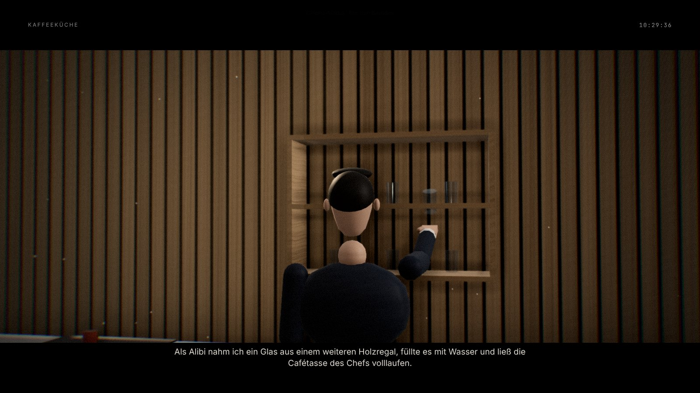

# Gefangen im Gefüge der Zeit – 3D-Story-Player

Ein lokal lauffähiger 3D-Player (Three.js + Vite + TypeScript), der die Kurzgeschichte
als inszenierte Szene mit Zeitleiste abspielt: 11 Kapitel, ca. 8 Minuten, vier Kameras,
Cinema-Modus mit automatischem Regie-Schnitt.



## Installation & Start

Voraussetzung: [Node.js](https://nodejs.org) ab Version 20 (empfohlen 22 LTS).

```bash
npm install
npm run dev
```

Der Browser öffnet sich automatisch unter <http://localhost:5173>. Auf „▶ Geschichte abspielen“
klicken, damit der Ton starten darf.

Als statische Website bauen (Ergebnis landet in `dist/`, läuft auf jedem Webserver):

```bash
npm run build
npm run preview
```

## Bedienung

| Taste | Funktion |
| --- | --- |
| Leertaste | Play / Pause |
| ← / → | 5 s zurück / vor · mit ⇧ ein Kapitel |
| , / . | Einzelbild zurück / vor |
| + / − | Geschwindigkeit (0,25× – 2×) |
| 1 | Filmkamera (Kamerafahrten, Schnitte, Brennweiten aus der Timeline) |
| 2 | Ego-Perspektive (Maus ziehen = umsehen) |
| 3 | Third Person (ziehen = drehen, Mausrad = Abstand) |
| 4 | Freie Kamera: ins Bild klicken, dann WASD + Maus, Shift = schneller, Q/E = runter/hoch |
| Tab | nächste Figur für Ego/Third Person (oder Auswahl oben rechts) |
| C / Esc | Cinema-Modus an / aus (Letterbox 2.39:1, Regie-Schnitt, keine UI) |
| K | Sichtkegel der Überwachungskameras |
| N · U · M | Namen · Untertitel · Ton |
| F | Vollbild · H = Hilfe |

Qualität (Hoch / Mittel / Niedrig) oben rechts. Die Einstellung wird gespeichert, daneben
stehen FPS und Frame-Zeit. Auf dem M1 empfehle ich **Mittel** für stabile 60 FPS im Fenster
und **Hoch** für Standbilder bzw. kleinere Fenster.

| Stufe | Pixeldichte | Schatten | SSAO (GTAO) | Tiefenunschärfe | Bloom | MSAA |
| --- | --- | --- | --- | --- | --- | --- |
| Hoch | bis 1,5× | 2048 weich | ✔ | ✔ | ✔ | 4× |
| Mittel | 1× | 1024 weich | ✔ | – | ✔ | 2× |
| Niedrig | 0,75× | 512 | – | – | – | – |

Filmlook (alle Stufen): ACES-Tonemapping, Farbgrading pro Lichtstimmung, Filmkorn, Vignette,
leichte chromatische Aberration, Nebel und volumetrische Lichtschächte im Büro.

URL-Parameter für schnelles Arbeiten: `?t=230` (Startzeit in s), `&cam=third`, `&actor=ceo`,
`&cinema=1`, `&quality=medium`, `&cones=1`, `&timeline=timeline/andere.json`.

## Projektstruktur

```
public/
  timeline/story.json   ← DIE zentrale Timeline (alles Inhaltliche steht hier)
  models/               ← deine glTF/GLB-Modelle
  audio/                ← Musik, Atmo, Geräusche
  hdri/                 ← optionale .hdr-Umgebungen
src/
  timeline/             Datenformat (types.ts) + deterministische Auswertung (Timeline.ts)
  scenes/               Welt, Licht, Requisiten, Effekte
    sets/               Straße, Bürogebäude (Lobby, Aufzug, 8. Stock), Möbel
    actors/             Platzhalter-Figuren, Posen, Hund, Fahrzeuge, GLB-Anbindung
  cameras/              Film-, Ego-, Third-Person-, freie Kamera, Cinema-Regie, Überblendung
  engine/               Post-Processing & Qualitätsstufen
  audio/                Ton synchron zur Timeline (mit synthetischen Platzhaltern)
  ui/                   Player-Leiste, Kamera-Buttons, Untertitel, Cinema-Overlay
```

## Prinzip: Zeit rein → Zustand raus

Der Player speichert keinen Zustand, der sich „aufbaut“. Für jeden Zeitpunkt `t` wird die
komplette Welt aus `story.json` berechnet: Positionen, Posen, Türen, Requisiten, Licht,
Ampel, Verkehr, Bildschirm-Inhalte und Effekte. Deshalb stimmt beim Scrubben, Springen oder
Rückwärtslaufen immer alles.

## Timeline bearbeiten (`public/timeline/story.json`)

Nach dem Speichern genügt ein Neuladen im Browser (F5).

| Bereich | Inhalt |
| --- | --- |
| `meta.duration` | Gesamtlänge in Sekunden |
| `chapters` | Kapitel mit Startzeit `t` (Marker und Sprungziele in der Player-Leiste) |
| `storyClock` | Story-Uhr (z. B. 10:28 → 10:29:56), wird zwischen den Einträgen interpoliert |
| `waypoints` | benannte Orte `[x, y, z]` in Metern (y = 0 Gehweg/Lobby, 28,8 = 8. Stock) |
| `actors` | Figuren: Name, Platzhalter-Look, optional `model` + `animations` |
| `tracks` | pro Figur Schlüsselpunkte: `t`, `at` (Wegpunkt oder `[x,y,z]`), `pose`, `face`, `look` |
| `props` | Requisiten (Brief, USB-Stick, Tasse …): an Hand anhängen (`attach: "protagonist.handR"`), ablegen, werfen (`fly`) |
| `events` | `subtitle` (dialog/thought/letter/narration), `light`, `sound`, `door`, `state`, `screen`, `fx` |
| `shots` | Filmkamera: `from`/`to` (Fahrt), `look`, `lens` in mm (`lensTo` = Zoom), `shake`, `aperture` |
| `inserts` | Hinweise für den Cinema-Regisseur, wo Schnittbilder hingehören |

Beispiele:

```jsonc
// Figur läuft von A nach B (Pose gilt bis zum nächsten Schlüsselpunkt)
{ "t": 12.0, "at": "st.corner", "pose": "run" },
{ "t": 16.4, "at": "st.approach", "pose": "breathe", "face": 0 }

// Kameraeinstellung: Fahrt relativ zur Figur, Blick auf den Kopf, 50 → 85 mm
{ "t": 60, "name": "Nah", "from": { "rel": "protagonist", "socket": "head", "offset": [0.3, 0, 1.3] },
  "look": { "actor": "protagonist", "socket": "head" }, "lens": 50, "lensTo": 85 }
```

Verfügbare Posen stehen in `src/scenes/actors/poses.ts` (z. B. `walk`, `run`, `sneak`, `crawl`,
`crouch`, `read`, `sit_type`, `phone`, `talk`, `startled` …).

## Eigene Modelle einsetzen (glTF/GLB)

1. Datei nach `public/models/` legen, z. B. `public/models/protagonist.glb`
2. In `story.json` bei der Figur eintragen:

```json
"protagonist": {
  "model": "models/protagonist.glb",
  "modelScale": 1.0,
  "modelYaw": 0,
  "animations": { "idle": "Idle", "walk": "Walking", "run": "Running", "read": "Reading" },
  "bones": { "head": "mixamorigHead", "handR": "mixamorigRightHand", "handL": "mixamorigLeftHand" }
}
```

Die Figur blickt in +Z (sonst `modelYaw` anpassen). Animationen laufen über den
`AnimationMixer` und werden ebenfalls deterministisch aus `t` berechnet. Posen ohne
Zuordnung fallen auf `idle` zurück. Requisiten (`props.<id>.model`) und das Auto
(`black_sedan`) werden genauso ersetzt. Fehlt eine Datei, bleibt der Platzhalter und in der
Konsole erscheint ein Hinweis.

Die Platzhalter heißen in der Szene `<id>.placeholder`, die Requisiten `prop.<id>`.

## Ton austauschen

Alle Sound-Einträge der Timeline haben ein `file`-Feld (z. B. `"file": "husky_bark.mp3"`).
Liegt die Datei in `public/audio/`, wird sie verwendet. Sonst erzeugt der Player einen
synthetischen Platzhalter (Stadt-Atmo, Büro-Brummen, Herzschlag, Ding, Bellen …).
Die erwarteten Dateinamen stehen in [`public/audio/README.md`](public/audio/README.md).

## HDRI-Beleuchtung

Standardmäßig wird die Umgebung prozedural erzeugt (physikalischer Himmel draußen, Studio-Raum
drinnen). Für echte HDRIs (z. B. von polyhaven.com) die `.hdr`-Datei nach `public/hdri/`
legen und in `story.json` eintragen:

```json
"assets": { "hdri": { "exterior": "hdri/street_morning_2k.hdr", "interior": "hdri/office_2k.hdr" } }
```

## Lichtstimmungen

`light`-Ereignisse wählen Presets aus `src/scenes/Lighting.ts` (`street_morning`,
`street_show`, `office_tension`, `ceo_office`, `hiding`, `relief`, `street_finale` …) und
blenden über `blend` Sekunden weich über. Jedes Preset steuert Sonne, Umgebung, Belichtung,
Nebel, Lichtschächte, Bloom, Vignette, Korn und Farbgrading.
